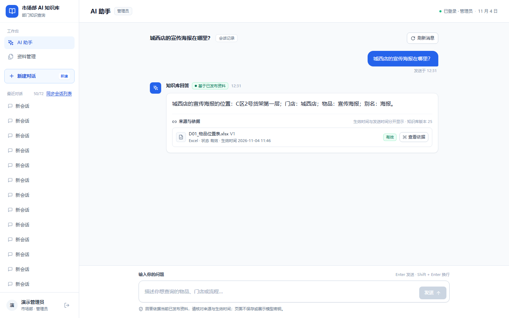
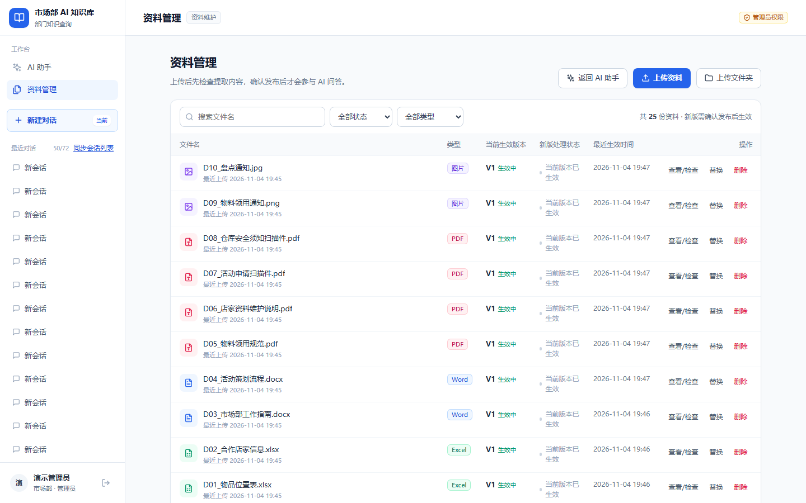
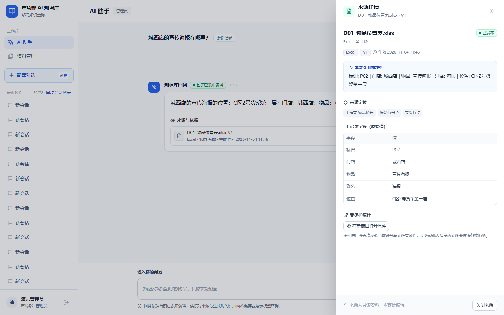
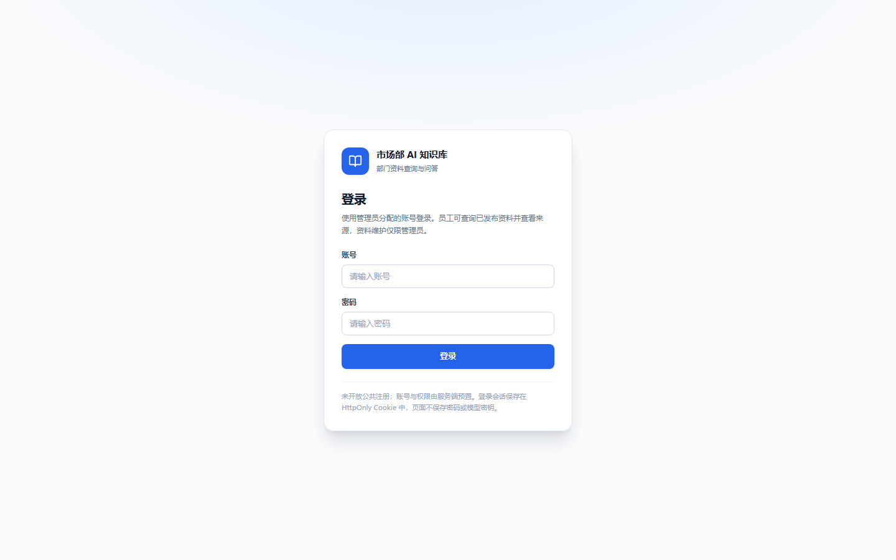
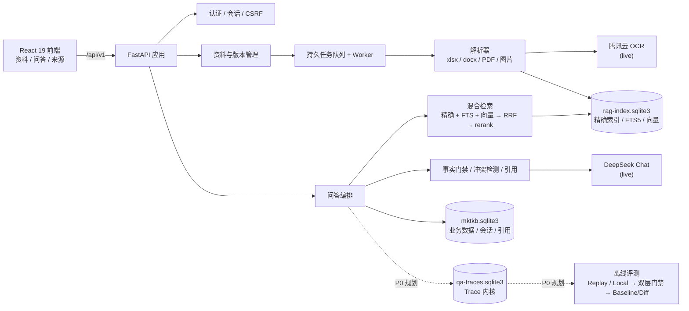

<div align="center">

# 市场部 AI 知识库 · MKTKB

**把散落在表格、制度、通知和扫描件里的部门资料，变成一个「有来源、可追溯、敢说不知道」的 AI 问答知识库。**

<p>
  
  
  
  
  
  
</p>

<p>
  <a href="#-项目简介">项目简介</a> ·
  <a href="#-功能特性">功能特性</a> ·
  <a href="#-界面预览">界面预览</a> ·
  <a href="#-系统架构">系统架构</a> ·
  <a href="#-技术栈">技术栈</a> ·
  <a href="#-快速开始">快速开始</a> ·
  <a href="#-测试与评测">测试与评测</a> ·
  <a href="#-当前状态与已知限制">当前状态</a> ·
  <a href="#-路线图">路线图</a> ·
  <a href="#-文档导航">文档</a>
</p>

</div>

---

## 📖 项目简介

市场部每天要回答很多「资料题」：城东店的宣传海报放在哪个货架？跨店调拨物料由谁确认？活动申请要提前几个工作日提交？这些答案散落在 Excel 表格、Word 制度、PDF 通知和扫描件里，人工翻找慢，直接问通用大模型又容易一本正经地编。

**MKTKB 是一个面向企业部门场景的本地 RAG 知识库**：管理员上传资料 → 系统解析、建索引、按版本发布 → 员工用自然语言提问 → 得到带来源引用的答案；资料里没有的，就明确返回「未找到」，而不是猜。

设计上坚持三条原则：

1. **能精确就别语义**：表格里的门店、物品、字段值走结构化记录检索；流程、制度、正文类问题走语义检索，两条路各有门禁。
2. **答案必须可溯源**：每条回答引用已发布资料的具体单元；无引用、伪造值、跨实体、失效来源一律拒绝。
3. **知识有版本**：资料可替换、可删除、按版本发布；回答与引用绑定当时的知识库 revision，答案不会「穿越」到新版本。

> ℹ️ 本项目为个人作品 / 学习项目，不是 SaaS 服务。仓库内语料全部为**模拟数据**；模型、向量与 OCR 服务通过各自官方 API 在本地运行时接入，真实调用默认关闭，费用受本地预算账本约束。

## ✨ 功能特性

### 📚 资料管理

- 支持 **xlsx / docx / PDF / png / jpg / jpeg**（单文件 ≤ 20MB，PDF ≤ 50 页，Excel ≤ 5000 数据行，图片 ≤ 2000 万像素）
- 上传即创建**持久处理任务**：worker 租约 + 心跳续期 + 检查点恢复，中断后可续跑
- 解析结果可预览、可重试、可查看处理报告
- **版本化与生命周期**：追加新版本、发布 / 取消、逻辑删除；发布前对索引完整性逐项核对
- 管理员可查看受保护原件；员工只能通过消息引用访问，服务端校验归属

### 🔍 检索与问答

- **混合召回**：结构化精确检索（门店 / 物品 / 字段）＋ 中文全文检索（jieba + SQLite FTS5）＋ 向量召回，**RRF 融合**后可选 **rerank**
- **事实门禁**：拒绝伪造值、跨实体、跨字段、无引用、失效来源
- **业务日期过滤**：按业务基准日过滤未生效 / 已失效资料（历史版本不串台）
- **六类结果**：`answer` / `clarification` / `not_found` / `conflict` / `service_error` / `knowledge_changed`
- **引用溯源**：答案返回来源单元，可查看引用详情与受保护原件
- **多轮会话**：支持槽位继承与短追问（当前版本对未识别门店的继承逻辑有已知缺陷，见「当前状态」）

### 🛠️ 工程化

- **请求幂等**：`(conversation_id, client_request_id)` 唯一约束 + 在途请求防护 + 迟到结果 fencing
- **提交事务**：回答落库前重检 revision、会话归属与引用有效性，避免过期答案落库
- **预算账本**：真实调用前预留、按实际 usage 结算、失败留账、阶段额度 / 请求上限、零自动重试
- **全本地运行**：SQLite 单机 + Alembic 迁移 + `.env` 隔离凭据，不依赖云服务
- **948 个 pytest 用例** + Playwright 端到端测试
- Windows **一键启动**：后端 + 前端 + 文件自动处理，一个窗口跑完整套服务

## 🖼️ 界面预览

> 本地运行实拍（模拟语料，管理员视角）。

<table>
  <tr>
    <td width="50%"><br><sub>问答：答案 + 来源与依据</sub></td>
    <td width="50%"><br><sub>资料管理：类型 / 版本 / 状态</sub></td>
  </tr>
  <tr>
    <td width="50%"><br><sub>来源详情：原文、定位与原始字段</sub></td>
    <td width="50%"><br><sub>登录：服务端预置账号</sub></td>
  </tr>
</table>
## 🏗️ 系统架构



- 资料库与索引库**物理分离**（`mktkb.sqlite3` / `rag-index.sqlite3`），问答不直接读写业务主库
- 精确检索、全文检索、向量召回在检索层内完成融合与重排，事实门禁在生成前后各校验一次
- P0 阶段将新增**独立 Trace 库**与离线评测器，不改动现有问答行为（见 [路线图](#-路线图)）

## 🧰 技术栈

| 层次 | 选型 |
| --- | --- |
| 后端框架 | Python 3.12 · FastAPI 0.162 · Uvicorn 0.54 |
| 数据层 | SQLite（WAL + FTS5）· SQLAlchemy 2.1 · Alembic 1.20 |
| 配置与校验 | Pydantic 2.14 · pydantic-settings |
| 文档解析 | openpyxl 3.1 · python-docx 1.2 · pdfplumber 0.11 · pypdfium2 5.14 · Pillow 13 |
| 中文检索 | jieba 0.42（本地词典）· SQLite FTS5 · numpy 2.5（向量矩阵） |
| 模型服务 | DeepSeek Chat Completions（httpx 0.28）· DashScope text-embedding-v4 · gte-rerank-v2 · 腾讯云 OCR |
| 前端 | React 19 · TypeScript 5.9 · Vite 8 · React Router 7 |
| 测试 | pytest（948 用例）· Playwright 1.64 |
| 运行环境 | Windows 本地；Python 3.12.7 / Node.js ≥ 22.12（Linux / macOS 未验证） |

## 🚀 快速开始

### 环境要求

- Windows 10 / 11（本地开发环境；Linux / macOS 未验证）
- Python **3.12**（仓库按 3.12.7 开发）
- Node.js **≥ 22.12**（前端）
- 可选：DeepSeek / DashScope / 腾讯云 OCR 凭据（仅「真实问答」模式需要）

### 1. 安装

```powershell
git clone https://github.com/Echo2580/mktkb.git
cd mktkb

python -m venv .venv
.\.venv\Scripts\python.exe -B -m pip install -r backend\requirements-dev.lock
.\.venv\Scripts\python.exe -B -m pip install --no-deps -e backend
```

### 2. 配置

```powershell
Copy-Item .env.example .env
```

`.env` 至少填写：`MKTKB_CSRF_SECRET`（≥16 字符）、`MKTKB_ADMIN_PASSWORD`、`MKTKB_EMPLOYEE_PASSWORD`。
需要真实问答 / OCR 时再填模型与 OCR 凭据；真实密钥只放本机 `.env`，不会进入仓库或前端。

### 3. 初始化与启动

```powershell
# 数据目录 + 数据库迁移（幂等）
New-Item -ItemType Directory -Force -Path var | Out-Null
.\.venv\Scripts\python.exe -B -c "from mktkb.db import run_migrations; run_migrations('sqlite:///var/mktkb.sqlite3')"

# 初始化内置账号（幂等：只补缺失账号，不重置已有密码）
@'
from mktkb.auth.service import bootstrap_accounts
from mktkb.config import Settings
from mktkb.db import Database

settings = Settings()
database = Database(settings.resolved_database_url())
with database.session_scope() as session:
    created = bootstrap_accounts(
        session,
        admin_username=settings.admin_username,
        admin_password=settings.admin_password,
        admin_display_name=settings.admin_display_name,
        employee_username=settings.employee_username,
        employee_password=settings.employee_password,
        employee_display_name=settings.employee_display_name,
        rounds=settings.bcrypt_rounds,
    )
print("created:", created)
'@ | .\.venv\Scripts\python.exe -B -
```

**方式 A（推荐）：一键启动** —— 双击根目录 `一键启动.cmd`，自动启动后端（默认 `127.0.0.1:8077`）、前端（默认 `127.0.0.1:5673`）与文件自动处理，并打印实际访问地址。

**方式 B：手工分窗口**

```powershell
# 后端
.\.venv\Scripts\python.exe -B -m uvicorn mktkb.main:create_app --factory --host 127.0.0.1 --port 8077

# 前端（另开窗口）
cd frontend
npm install
npm run dev
```

> 默认 RAG 提供方为 `offline`（不产生真实调用）。需要真实模型 / OCR 时，使用 `启动-真实问答.cmd` 或在环境变量中显式设置 `MKTKB_RAG_PROVIDER_MODE=live` 及凭据；真实调用会计入本地预算账本，请按需使用。

### 4. 登录与使用

打开前端地址，用 `.env` 中配置的管理员 / 员工账号登录 →「资料」页上传并发布资料 →「问答」页提问。答案下方可展开查看来源引用。

## 🧪 测试与评测

```powershell
# 全量自动化测试（预算门相关用例需要与 .env.example 一致的总额度）
$env:MKTKB_PROJECT_TOTAL_LIMIT_CNY = "20.0"
.\.venv\Scripts\python.exe -B -m pytest backend/tests -q -p no:cacheprovider --basetemp backend\.pytest-tmp\readme
```

- `backend/tests/unit`：解析器、分词、意图、模型协议等纯单元用例
- `backend/tests/integration`：登录 / 上传 / worker / 发布 / 检索 / 会话 / 来源 / 恢复
- `backend/tests/rag`：RAG 内核、事实门禁、预算与结算
- `backend/tests/acceptance`：冻结语料与端到端验收支撑
- `frontend`：Playwright 端到端（`npm run test:e2e`，需要后端与前端已启动）

**真实质量矩阵**（2026-11-04，v0.1 冻结版）：40 题真实调用实测 **31/40**，其中精确记录题 **24/24**、语义 / 扫描件题 **7/16**。失败集中在流程规范类问题的「记录路」路由缺陷，详见 [错误记录](错误记录-20261104.md)。

> P0 阶段将引入确定性离线评测：B0 40 题 + Bad Case 13 题 → Replay / Local 双模式 → 硬门禁 + 分 stratum 质量门禁 → Baseline / Diff 报告。评测方案见 [设计文档](docs/superpowers/specs/2026-11-04-mktkb-observability-evaluation-design.md) 与 [P0 计划](docs/superpowers/plans/2026-11-04-mktkb-observability-evaluation-p0.md)。

## 📊 当前状态与已知限制

**v0.1 本地交付版**（2026-11-04 冻结，tag `v0.1-local-20261104`）：

| 指标 | 值 |
| --- | --- |
| 自动化测试 | 948 passed / 0 failed |
| 真实 40 题矩阵 | 31/40；精确题 24/24；语义 / 扫描件题 7/16 |
| 真实调用成本 | 共享账本保守占用 15.050980 / 20 元（供应商实账未核对） |
| 本地演示索引 | 25 文档 / 642 units / 457 chunks |
| 部署状态 | 未部署公网；无域名 / HTTPS |

**已知缺陷**（本版冻结不修，待 P0 评测门禁建立后按顺序修复）：

| 编号 | 级别 | 问题 |
| --- | --- | --- |
| D4 | P1 | 流程 / 规范类问题被路由成「记录枚举」，候选过多后直接返回澄清，不回落语义检索 |
| D1 | P1 | 预发送阶段异常被统一包装成 `MODEL_UNAVAILABLE`，真实原因丢失 |
| D5 | P2 | 未识别门店词（如「城西区」）会沿用上一轮门店，可能张冠李戴 |
| D6 | P2 | 字段错配 / 含糊问题直接吐整条记录，未澄清 |
| D3 | P2 | 澄清文案与实际原因不符 |

**其他限制**：

- 未部署公网；无 HTTPS / 域名；未做多浏览器与真机验收
- 容量（100 资料 / 10000 记录 / 3 并发）与供应商错误形态（429 / 超时 / 5xx）未系统验证
- 扫描件识别质量依赖真实腾讯 OCR，离线测试中仅以替身 / 跳过覆盖
- Holdout 30 题集尚未建立（P1 引入）
- 真实供应商实账未核对；账本为保守口径，不等于账单

## 🗺️ 路线图

| 阶段 | 内容 | 状态 |
| --- | --- | --- |
| **v0.1 本地交付** | 资料管理 / 检索 / 问答 / 权限 / 预算账本 / 一键启动 / 真实链路小样本验证 | ✅ 已冻结（`v0.1-local-20261104`） |
| **P0 评测与可观测性** | Trace 内核 + SQLite 存储、确定性评测器（Replay / Local）、双层发布门禁、Baseline / Diff、JSON / Markdown / HTML 报告 | 📐 设计定稿，任务拆解待审 |
| **P1 修复与检索评测** | 按 D4 → D1 → D5 → D6 → D3 修复；Holdout 30；真实 embedding / rerank 的检索级评测；监控 API | 🗓 计划 |
| **P2 真实效果评测** | 预算内 live 端到端评测；Ragas 软指标；可选 Langfuse 导出 | 🗓 计划 |
| **P3 看板与部署** | 历史趋势 / 告警看板；HTTPS / 域名部署与备份恢复 | 🗓 计划 |

## 📁 目录结构

```text
├─ backend/                 FastAPI 应用
│  ├─ src/mktkb/            认证、资料、任务、会话、检索、RAG、预算、来源
│  ├─ migrations/           Alembic 迁移（0001 → 0005）
│  └─ tests/                unit / integration / rag / acceptance
├─ frontend/                React 19 + TypeScript + Vite 前端
├─ tools/                   语料生成、受控真实调用、启动器、探针
├─ fixtures/                冻结验收语料（只读，D01–D10 / 边界样本 / 64 题）
├─ corpus/                  企业模拟资料库（69 文件 / 155 题答案键）
├─ docs/                    需求、技术方案、契约、验收矩阵、进度、P0 方案
├─ 原型设计/                 早期 HTML 交互原型
├─ 一键启动.cmd              Windows 本地一键启动
├─ 启动-真实问答.cmd         live 模式启动（真实供应商 / 预算账本）
└─ .env.example             配置模板（真实凭据不进仓库）
```

## 📚 文档导航

| 文档 | 内容 |
| --- | --- |
| [产品需求文档](市场部AI知识库-产品需求文档.md) | 目标、范围、用户故事与验收边界 |
| [技术方案](市场部AI知识库-技术方案.md) | 选型、数据设计、导入 / 检索 / 发布 / 部署方案 |
| [接口与数据契约](docs/接口与数据契约.md) | API 契约、错误码、六类结果结构 |
| [验收矩阵](docs/验收矩阵.md) | 功能验收项与判定口径 |
| [项目进度](docs/项目进度.md) | 分阶段进度、裁决与证据索引 |
| [本地交付说明](本地交付说明-20261104.md) | v0.1 可用入口、实测结果、成本与未覆盖项 |
| [错误记录](错误记录-20261104.md) | 缺陷台账（ERR-20261104-01 ~ 07） |
| [测试场景对照](测试场景对照与注意事项-20261104.md) | 手工验收场景与判分口径 |
| [P0 设计](docs/superpowers/specs/2026-11-04-mktkb-observability-evaluation-design.md) | 评测与可观测性方案（定稿） |
| [P0 实施计划](docs/superpowers/plans/2026-11-04-mktkb-observability-evaluation-p0.md) | Task 1–7 实施步骤与验收映射 |
| [语料说明](corpus/enterprise-20261101/README.md) | 企业模拟资料库结构与分组 |
| [冻结语料说明](fixtures/acceptance/README.md) | 验收冻结语料与 B0 初始化配方 |

## ⚠️ 数据与合规说明

- 仓库内全部语料为**模拟 / 虚构数据**（公司、门店、人名、电话、价格均无真实指向）；`corpus` 中 3 份法规原文来自公开政务网站。
- `.env`、业务数据库、运行证据均不进入仓库；真实凭据只在运行时从本机 `.env` 读取。
- 真实模型 / OCR 调用按官方价格计费，项目内置预算账本（预留 / 结算 / 失败留账 / 阶段上限），不会静默超支。
- 本项目仅用于学习与作品展示；请勿直接用于生产环境的真实业务数据处理。

## 🙏 参考项目

设计思路上参考了以下同类开源项目（排名不分先后）：

- [RAGFlow](https://github.com/infiniflow/ragflow) —— 文档解析与可解释 RAG 流程
- [FastGPT](https://github.com/labring/FastGPT) —— 知识库构建与问答编排
- [AnythingLLM](https://github.com/Mintplex-Labs/anything-llm) —— 本地优先的一体化知识库体验
- [QAnything](https://github.com/netease-youdao/QAnything) —— 中文场景的本地问答实践

## 📄 License

本仓库目前**未声明开源许可证**（All rights reserved），公开用于展示与学习。如需引用或复用代码 / 语料，请先联系作者。

---

<div align="center">
<sub>Built with FastAPI · React · SQLite FTS5 · DeepSeek · 本地优先</sub>
</div>
