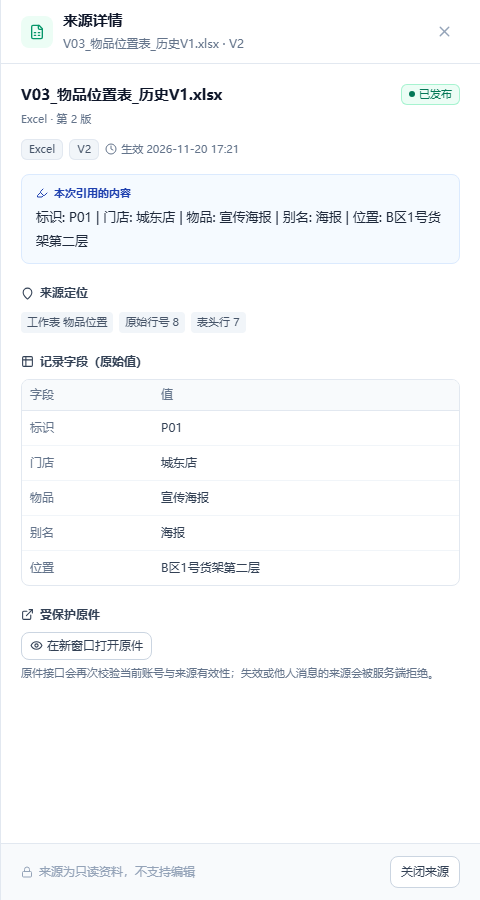

# P2 · T900 正式总验收报告

**角色**　全新独立验收窗口 `t900-acceptance`（非开发方；同一窗口完成阶段一、阶段二）。
**日期**　2026-11-21（Asia/Shanghai）。
**现场**　分支 `codex/p2-e2e`，HEAD `97b0066726e5b8d6f94cbc0b63a890084550c106`。
**冻结候选**　[candidate-freeze.md](../candidate-freeze.md) / [candidate-freeze.json](../candidate-freeze.json)（`p2-candidate-freeze/v0.2`，`frozen_at_local=2026-11-21T01:16:20+08:00`）。
**结论**　**有保留通过**。技术门通过、B0/N/C/U/H2 与八项硬门禁达标、档案可恢复、浏览器通过、本轮新增真实请求/费用为 0；保留项见 §12，均为已披露的受控口径/受限证据/主人决定权，不构成任务书规定的阻断条件。

## 0. 冻结门（v0.2，独立复核）

命令：

```powershell
.\.venv\Scripts\python.exe docs\reports\OBS-EVAL\P2\evidence\T900\probes\freeze_v2.py `
  docs\reports\OBS-EVAL\P2\evidence\T900\probes\out\freeze_v2_final.json
```

实际结果（`logs/freeze-v2.log`、`probes/out/freeze_v2*.json`）：

| 项 | 结果 |
| --- | --- |
| `frozen_artifacts` | **47 项**，逐字节 SHA-256/字节数 **drift 0**、missing 0 |
| `records_append_only` | **2 项**（`manager-decisions.md` 16,145 B / `manager-acceptance.md` 21,633 B）；`sha256(current[0:bytes_at_freeze]) == sha256_at_freeze`，**prefix violations 0** |
| 正式门禁 JSON | `d4c98f92c0873addbda01b28394b292b3fcd4bdec2aa39a25af6b8384ba66461` / 53,053 B，匹配 |
| 批准配置 | `b1094cc726230be2ec22ec811d34a948ea4a2fe03aab2c0fcc4f20c99764d961` / 5,785 B，匹配 |
| 退出码 | **0** |

- v0.1 的 `manager-acceptance.md` 单体漂移（`5edeade6…`/17,265 B → 实际 `e2831432…`/19,857 B）已由 D-012/`v0.2` 两类冻结规则解决；本轮不再把台账追加误判为技术工件漂移。
- 本窗口只读；未写入任何冻结件。台账后续追加在 `append_only_prefix` 规则下合规，旧前缀被改写仍会被本探针拒绝。

## 0.1 状态总表（21 项）

| # | 核验 | 状态 | 主要证据 |
| ---: | --- | --- | --- |
| 1 | v0.2 冻结门（47 技术工件 + 2 台账前缀） | PASS | `probes/out/freeze_v2_final.json`，exit 0 |
| 2 | 正式门禁独立复跑与字节比对 | PASS | `phase2/gate-result.rerun.json`、`gate-rerun-compare.json`，exit 0 |
| 3 | 47 行逐行（38/0/0/9、行 id、reason_codes） | PASS | `probes/out/gate_audit.json`（50 项 0 失败） |
| 4 | B0 40/40、38 通过、24/24、OCR 8/8 | PASS | §2；`phase2/b0-admit.json` |
| 5 | N 8/8 | PASS | §3；`negative` 行 |
| 6 | C 6/6 | PASS | §3；`boundary` 行 |
| 7 | U 10/10（1R+9L，两行 tally 7/2/9、8/6/10） | PASS | §3；`u`、`tallies.*` 行 |
| 8 | H2 30/36、五层、29/30、硬失败 0、必需未知 0 | PASS | §4；`h2.*` 行 |
| 9 | C25 双列（历史 1 / 派生 0） | PASS | §4；H2 报告 §5/§12.7 |
| 10 | 四卡文件/聚合哈希分列 | PASS | §4；`h2.cards_index`/`h2.card.*` |
| 11 | `h2-source-proof.full.json` 过校验器 | PASS（受限） | §4；`h2.source_proof` |
| 12 | 八项硬门禁适用性 + 最小样本（含 D-011） | PASS | §5、§6 |
| 13 | D-011 专项 + 自造 run 级失败 | PASS | `probes/out/d011_probe.json` |
| 14 | 自写错绑定 / 假适用性负例 | PASS | `probes/out/negatives_probe.json` |
| 15 | B0 verify/restore/list/diff/admit | PASS | §2；`logs/b0-phase2.log` |
| 16 | T208 真实裁判 / 拒答 / 错误边界 / 费用授权 | PASS（受限） | §8；`probes/out/t208_audit.json` |
| 17 | 资金 / 权限 / 请求上限 / 供应商实账 | PASS（受限） | §9；`probes/out/funds_audit_phase2.json` |
| 18 | 本轮新增真实请求/费用 = 0 | PASS | §9；`logs/phase2-zero-new-usage-final.txt` |
| 19 | 浏览器 T08 + acceptance-05 | PASS | §10；`browser/d3p2/` |
| 20 | T201–T209 + 四新包三层证据 | PASS（历史漂移限制） | §11；`manager-acceptance.md` |
| 21 | T900 真实抽验 | NOT-RUN | P-002；本轮零真实请求/费用 |

## 0.2 四类证据分列

| 证据类别 | 本报告覆盖 | 边界 |
| --- | --- | --- |
| 开发自测 | §11 各包 `report.md` / dev-report | 只证明开发记录存在，不当作 T900 实测 |
| 独立离线 | §0/§1/§6/§7 及 T900 自写探针、复跑门禁、负例、B0 档案 | 本窗口实际命令/退出码/产物 |
| 已有真实运行 | §2 B0、§8 T208、§9 账本、§11 T206/T207/T209 | 只读回执/账本/admission；未重放、未新增请求 |
| 浏览器 | §10 T08 + acceptance-05 | 离线 stub/受控替身；非真实模型/OCR；断言对应实际接口响应 |

## 1. 正式门禁独立执行（不读报告）

命令（输出到隔离目录）：

```powershell
$env:P2_RELEASE_NCU_OUT = 'D:\GPT项目\市场部AI知识库\.tmp-t900-isolated\phase2\gate-rerun.json'
.\.venv\Scripts\python.exe docs\reports\OBS-EVAL\P2\CROSS-SCENARIO-GATE\scripts\wire_real_ncu.py
```

实际结果：

| 项 | 值 |
| --- | --- |
| 退出码 | **0** |
| stdout | `{"ok": true, "decision": "pass", "counts": {"pass": 38, "blocked": 0, "pending": 0, "observed": 9}, "reason_codes": []}` |
| 重跑产物 | `phase2/gate-result.rerun.json`，SHA `d4c98f92c0873addbda01b28394b292b3fcd4bdec2aa39a25af6b8384ba66461` / 53,053 B |
| 与冻结 JSON | **逐字节相同**（`phase2/gate-rerun-compare.json`：`byte_identical=true`） |

47 行核对（`probes/out/gate_audit.json`，**50 项断言，0 失败**）：

| 项 | 实测 |
| --- | --- |
| 行数 / 行 id | 47；与冻结 `row_ids` 集合相同；`sha256(sorted ids joined by 换行)=985d0556…` 与冻结一致 |
| 判定计数 | 38 `pass` / 0 `blocked` / 0 `pending` / 9 `observed` |
| `reason_codes` | `[]` |
| 总门 | `decision=pass`、`technical_gate=pass`、`release_allowed=false`、`release_authority=owner`、`owner_release_decision=not_decided` |
| 正式配置 | `gate_config_hash=7fa6f47a…`；文件 SHA `b1094cc7…` |
| 披露行 | `hard_gate_min_sample.run_level_subset` 在列，`suite_planned_cases=10 / required_min_sample=10 / run_level_evaluated=1 / basis=suite_planned_cases / covered=true` |
| 证据清单 | `evidence_manifest` 三摘要匹配；`SHA256SUMS` 17/17 命中、mismatch 0、missing 0 |
| 47 行 id 集合摘要 | `985d055638477e5f44b5b696b0d72b2c5a3676a8350c6bdabcd584ae71730d5b`（与冻结登记一致） |

## 2. B0（正式基线 `7981d4afc2d1`）

命令与退出码见 `logs/b0-phase2.log`：

| 命令 | 退出码 | 结果 |
| --- | ---: | --- |
| `baseline verify --archive var\eval\t209-prep\b0-baseline-7981d4afc2d1\archive` | 0 | 13 文件、`approved=yes`、manifest SHA `be511c7e…` |
| `baseline restore --archive … --root .tmp-t900-isolated\phase2\b0\baselines --runs-root …\runs` | 0 | 13 文件；7 份运行工件与源/归档逐字节一致；仅 `baseline.json` 的 `run_dir` 重写（2067→2080 B） |
| `baseline list --root …\baselines` | 0 | 只列 `7981d4afc2d1` |
| `baseline p2-diff --run … --gate-config gate_v0_3_approved.json --baseline 7981d4afc2d1 --root …` | 0 | `baseline_approved=true`；`still_failing=["Q25","Q33"]`；`new_failures=[]`；`current_b0` 见下 |
| `baseline p2-admit --run … --gate-config … --out …\admit.json` | 0 | `evidence_sha256=2226fa208aec7db84ab69e5f7a068e94322414d38b90c14399979b96fcea8b5d`；proof 与存档逐字段相等 |

B0 实测：40/40 执行、38 通过、精确 24/24、OCR 8/8 执行（7 通过）、hard_failures `[]`、unknown 0、`min_sample=32`、`scored_count=40`。Q25、Q33 仍失败（如实保留）。B0 八项硬门禁：`citation_required=pass`、`exact_value_contract=pass`、`trace_integrity=pass`，其余 `not_applicable`。

说明：B0 归档 `b0-admission.json` 内的 `p2_release_status` 仍是 B0 当时写入的 `blocked_pending_n_c_u_h2_evidence`，归档未改写；该字段不被 T900 当作当前跨场景门的最终状态，当前技术输入以冻结 `gate-result.real-ncu.json` 为准（§12-L9）。

## 3. N / C / U

| 套件 | 评分层 | 无条件可采（无机械 FAIL） | 正式可采（含 D-005 证明） |
| --- | ---: | ---: | ---: |
| N | **8/8** | 7/8 | **8/8** |
| C | **6/6** | 2/6 | **6/6** |
| U | **10/10**（1 真实 smoke + 9 本地控制） | 9/10 | **10/10** |

- `tallies.unconditional = 7/2/9`（observed），`tallies.formal = 8/6/10`（pass）；两行均在 47 行中。
- 24 个 case（N8+C6+U10）逐案计数：`ADOPTED` 7/2/9，`ADOPTED_WITH_BINDING_PROOF` 1/4/1；6 条证明档的原始机械 FAIL 与 `binding_proof` 均保留（未改写成 clean pass）。
- U01：原始 `citation_required=fail`、`trace_integrity=fail` 保留；D-004 修正视图 `citation_required=pass`，D-005 绑定证明后 formal 计入 10/10。`u.citation` 为 `observed`，明确披露“mechanical_before=fail / after_d004=pass”；`binding.p2-t207-r2` 同时列 `original_mechanical` 与 `corrected_view`。
- 八门汇总中 U 的 `trace_integrity` 为 **N/A**（suite 行未评估 trace），原始 fail 与 D-005 修正 pass 只在 `binding.p2-t207-r2` 行分列；这不把 U 的 trace 计为 pass，属披露/适用性限制（§12-L12），不能反读为“U trace 已通过”。
- 零新增真实请求：`network_evidence.new_real_requests=0`、`new_model_or_api_calls=0`、`production_data_or_real_provider_execution=0`；`release_decision=false`。

## 4. H2 同批

| 项 | 实测 |
| --- | --- |
| 覆盖 | 30 题 / 36 回合，`not_started=0`、`status=complete` |
| 五层 | `paraphrase 10 / multi_turn 5 / negative 5 / stale_conflict 5 / cross_doc_security 5` |
| 质量 | **29/30**（failed 1），≥24/30 |
| 硬失败 | **0**（safety/cross_user/cross_entity/stale_source 均 0） |
| 必需未知 | **0** |
| 整卡 verified | 四卡 `true`，组合 `true`；`threshold_met=true` |
| 来源证明 | `h2-source-proof.full.json` SHA `f6465fcb…`；gate 校验器 `h2.source_proof=pass`；`zero_call={new_requests:0,new_outbound:0,replayed:false}` |
| 四卡文件哈希 | `14888a0f…`、`ccc9c12c…`、`15286a96…`、`8e95138d…`（`card_sha256`） |
| 四卡聚合哈希 | `6fd2a94c…`、`0d993f5d…`、`f8798049…`、`0fb46ecb…`（`aggregate_sha256`/`derived_card_sha256`） |
| 两套哈希 | 4/4 文件哈希与聚合哈希均不相等；`derived_card_sha256` 与组合 `aggregate_sha256` 逐值相等；未混用 |
| C25 | 双列成立：历史 live `unknown / forbidden_source_unmappable` = **1**；本派生 `not_applicable` = **0**（H2 报告 §5/§12.7；gate `h2.non_required_axes` observed，count=0，注明历史值在报告） |

**受限边界**：卡本体按 D-001 留在保管环境，T900 只做聚合外层核验；29/30 的逐题重算与 C25 历史值不能从卡本体独立复核，记 `NOT-VERIFIED（受限）`（§12-L3）。

## 5. 八项硬门禁与最小样本

| 门禁 | B0 | N | C | U |
| --- | --- | --- | --- | --- |
| `security_leak` | N/A | N/A | **pass** | N/A |
| `cross_entity` | N/A | N/A | N/A | N/A |
| `stale_bypass` | N/A | N/A | N/A | N/A |
| `conflict_not_rejected` | N/A | N/A | **pass** | N/A |
| `exact_value_contract` | **pass** | N/A | N/A | N/A |
| `pagination_contract` | N/A | N/A | N/A | N/A |
| `citation_required` | **pass** | N/A | N/A | **pass（D-004 修正视图；原始 U01 fail 已披露）** |
| `trace_integrity` | **pass** | N/A | N/A | **N/A（U01 原始 fail 在 `binding.p2-t207-r2` 保留，D-005 修正视图 pass；suite 行未计 pass）** |

最小样本：`b0 32`（run 级 40）、`badcase 8`（8）、`boundary 6`（6）、`update_delete 10`（run 级 **1**，D-011 披露）、`regression 7`、`p2-holdout 30`。汇总行 `hard_gates=pass`；唯一 disclosed unknown 是 `min_sample_not_met`，其余 status 均 `pass/not_applicable`。`not_applicable_gates = cross_entity / pagination_contract / stale_bypass`，均按“数据集无该类输入”的既定口径，不称“已通过”。

## 6. D-011 专项（含自造 run 级失败）

`probes/out/d011_probe.json`（exit 0）：

| 检查 | 实测 |
| --- | --- |
| 真实覆盖 | `suite_planned_cases=10 / required_min_sample=10 / run_level_evaluated=1 / basis=suite_planned_cases / covered=true` |
| 自报 run 级放大 | `run_level_evaluated=99` 时 `suite_planned_cases` 仍 10、`covered=true` → 不读自报 |
| 伪造计划数 | 将 `p2_standards.update_delete_total` 改为 9（`run_level_evaluated=10`）→ `covered=false` → 只读 `p2_standards.total` |
| 输入契约自报 | 在输入清单加入 `hard_gate_min_sample={"suite_planned_cases":10}` → `decision=blocked`、`release_inputs_invalid` |
| **自造 run 级门禁失败** | 完整合成输入 + `u_kwargs={"failing_citations": True}`（U01 引用整段缺失）→ 总门 `blocked`；`u.hard_gates=blocked`（`release_hard_failure`）；`hard_gates=blocked`（`release_hard_failure`） |
| 同输入对照 | 未注入失败时 `decision=pass`、`u.hard_gates=pass`、`hard_gates=pass` |

结论：D-011 是**计数口径**修订（计划数覆盖），不是判据放宽；run 级失败仍会把 `u.hard_gates` 与汇总 `hard_gates` 双 blocked，未被掩盖。

## 7. 自写负例（独立于开发/复核脚本）

`probes/out/negatives_probe.json`（exit 0），均通过真实 `evaluate_release_gate` 执行：

| 负例 | 构造 | 结果 |
| --- | --- | --- |
| 错绑定 | 把 `cards-index.cards[0].card_sha256` 改成对应 `aggregate_sha256`（`6fd2a94c…`） | 总门 **blocked**；`h2.cards_index=blocked`，`release_identity_mismatch`，cause `card_file_sha_equals_aggregate` |
| 假适用性 | 把 R1 绑定证明 `attested_index_revision` 从 12 改成 99 | 总门 **blocked**；`binding.p2-t207-r1-20261111-01=blocked`，`release_binding_attestation_invalid`，declared 99 / actual 12 |
| 对照 | 未篡改输入 | `decision=pass`、`h2.cards_index=pass` |

## 8. T208 有限真实裁判

| 项 | 实测 |
| --- | --- |
| 调用 | 24 笔 HTTP 200 / 24 请求 ID / 0 重试 / 0 待结算（`receipt.json`、`closeout.json`） |
| 结果 | 4 条 scored；`T208-PUB-05` **unknown / refusal_not_applicable**，judge_calls=0、charged=0 |
| 硬失败 | `T208-PUB-04` 保留 `hard_failure=stale_source`（`hard_failure_with_judge_score=1`），未被软评分掩盖 |
| 费用 | 预留 0.448512、保守结算 **0.038300**；judge 中心累计 0.056988 ≤ 3.0；供应商实账字段空 |
| 授权 | GO `4fdd291d…`；plan `bad6d326…`；24/30 计划请求；`requests_sent=24` |
| 错误边界 | T208 IA 独立复验 19 项（NLI 失配→unknown+保守结算、后续 0 笔、过期/越权 GO、503 停止、预算）；T900 复跑 `test_p2_judge_budget.py` **27 passed** |

限制：T900 未重跑完整 Ragas 真实裁判套件（依赖独立 Ragas 0.4.4 环境），只复跑预算/错误边界定向文件并核对真实回执；完整套件证据沿用 T208 IA R02（§12-L8）。

## 9. 资金与权限

| 项 | 值 |
| --- | ---: |
| 项目上限 / 累计占用 / 余 | 40.0000000 / 37.1647137 / 2.8352863 |
| P2-LIVE 阶段上限 / 占用 / 余 | 24.0000000 / 22.0937692 / **1.9062308** |
| answer_retrieval | 4.5867812 / 上限 6.35 / 余 1.7632188 |
| ocr | 17.4500000 / 上限 17.50 / 余 0.05 |
| judge | 0.0569880 / 上限 0.10 / 余 0.043012 |
| independent | 0 / 上限 0.05 / 余 0.05 |
| 账本 | 2,679 预留 / 2,679 结算 / 待结算 0 / 孤儿 0 / 重复 reservation_id 0 |
| B0 | 112/112，预留 6.586448，保守结算 5.7200466；chat 22,047/2,319 tokens |
| B0 两次运行 | attempt2 5.7197526 + attempt3 5.7200466 = **11.4397992** |
| 供应商实账 | `provider_billed_cny` 非空 **0** 条（P-004，未知，只能账本保守口径） |

- **请求上限**：D-006 主人裁定以 B0 GO 的 `unlimited` 为准，2,679 笔**不构成违规**；T209 阶段任务书已明写该口径。原 §12 的 ≤2000 信封被取代。代码硬常量 1600 被 `unlimited` 哨兵跳过，属实现事实，不是越权。
- **本轮新增**：01:25 复核账本 `088dec5f…`、预算 `8f1b061b…`、GO `43e0f622…`，与阶段一/B0 运行后一致；账本最后一行仍为 `2026-11-20T11:31:46.309888Z`，之后 **0 行**，本轮真实请求/费用 **0**。
- **授权**：B0 GO 封存 `426c8228…`（当前固定槽为签发前 T207 GO `43e0f622…`，已过期，属任务书槽位恢复）；T208 GO `4fdd291d…`；T900 真实抽验经 P-002 判定不必要，未申请、未执行。

## 10. 浏览器（冻结候选上复跑）

| 用例 | 环境 | 结果 |
| --- | --- | --- |
| `02-chat.spec.ts`（7） + `04-kinds-and-isolation.spec.ts`（3） | T08 stub 后端 + Vite 5173，离线 | **10 passed / 0 failed**，38.9s，exit 0 |
| `acceptance-05-sources.spec.ts`（2） | 真实 FastAPI + seeded B0 + 受控模型/OCR，8188/5199 | **2 expected / 0 unexpected**，5.0s，exit 0；`external=[]`、`local_count=131` |

断言对应实际接口响应：a14 受保护原件 200 + `x-content-type-options=nosniff`；a19 删除 `doc-guide` applied、原件 410、旧消息来源失效、新问答未引用已删 D03。截图：`browser/d3p2/screenshots/t900-phase2/05-sources/01-a14-answer.png`、`02-a14-source-drawer.png`、`03-a19-before-delete.png`、`04-a19-expired-source.png`、`05-a19-new-chat-no-evidence.png`。端口 8077/5173/8188/5199 运行后均空闲。



## 11. 逐包三层证据与 D-007

| 包 | 开发自测 | 独立复核 | 经理核收 | 当前状态 |
| --- | --- | --- | --- | --- |
| T201–T209（历史包） | 各包 `report.md` / dev-report | 各包 `review*.md` | 原任务书 §7/§10 + 各包 receipt | 历史层已接收；早期源码摘要与当前树不再逐字节相同（历史漂移，见 §12-L10） |
| 任务 1 `H2-DOC-REBUILD` | `report.md` | `review.md` **PASS-WITH-RESERVATIONS** | `manager-acceptance.md` 任务 1 节“已核收（带保留）” | 已接收 |
| 任务 2 `H2-REBUILT-CARDS` | `report.md` | `review.md` **PASS-WITH-RESERVATIONS** | 台账任务 2 节“已核收（带保留）” | 已接收 |
| 任务 3 `NCU-RELEASE-EVIDENCE` | `report.md` + `manifest.json` + `SHA256SUMS` | `review.md` **PASS-WITH-RESERVATIONS**（R1–R6） | 台账任务 3 节“已核收（带条件）” | 已接收 |
| 任务 4 `CROSS-SCENARIO-GATE` | `report.md` + `gate-result.real-ncu.json` | `review.md` 四轮（首轮 FAIL→T4-R1→H2 接线→D-011 确认通过带保留） | 台账任务 4 节“已核收（带保留）” | 已接收 |
| 台账 | — | — | `manager-acceptance.md`、`manager-decisions.md` | v0.2 `append_only_prefix` 通过 |

**D-007 免除范围**（主人确认，`manager-decisions.md:83-89`）：仅“正式 B0 基线接收所需的额外独立结果复核”；**不覆盖** N/C/U 证据核定、H2 同批聚合、跨场景门禁、P2 发布决定、T900 独立总判定。原免除记录见 `T209-PREP/t209-b0-closeout.md:3` 与 `b0-attempt3-baseline-approval.json` 的 `reason`。T900 本轮独立重跑 B0 `p2-admit`（proof 与存档相等）只作补强，不构成对免除包的补做。

## 12. 仍存在的限制（如实写入，不因此判失败）

- **L1 发布权**：`release_allowed=false`、`release_authority=owner`、`owner_release_decision=not_decided`；T900 只给技术/独立结论，发布由主人决定。
- **L2 D-011 受控口径**：U 的八项硬门禁实际只在 **1 条 run 级样本**（U01）上评估，其余 9 条是本地控制；披露行 `hard_gate_min_sample.run_level_subset` 已在 47 行内，消费方不得删除。该修订已由主人 D-011 批准，未改配置数值。
- **L3 H2 卡本体受限**：卡本体按 D-001 留在保管环境；29/30 的逐题重算、C25 历史 unknown=1 的卡级复算不可做，记 `NOT-VERIFIED（受限）`；T900 只验证聚合、来源证明、卡文件 SHA、两层哈希分列和 360/360 双射声明。
- **L4 供应商实账不可得**：`provider_billed_cny` 全 null（P-004）；所有资金结论采用账本保守口径，不能称“供应商实际账单”。
- **L5 真实抽验未执行**：P-002 经理判定不必要（P2 阶段余 1.9062308、independent 余 0.05；离线门禁与 B0 恢复已闭合），记 `NOT-RUN`；如主人另要求，须另列题组、配额、费用上界、独立成本中心与新 GO。
- **L6 NCU 校验器内容级覆盖不足**：任务 3 独立复核 R2 披露，`verify_manifest.py` 对 3 个内容级篡改（题干哈希、幽灵证据路径、trace_id 互换）不拒；正式门禁不依赖该单验器，而由 `collect_suite` 从原始 run 数据重算，且本轮冻结门复跑逐字节一致。仍保留为证据完整性限制，不据此宣称“任何篡改都会被拒”。
- **L7 `gate.py` 中间态不可重建**：HEAD `7e54fbf6…`、D-004 前工作树 `10235099…`（未提交中间态，git 不可重建）、当前 `e04990db…`；本轮验证当前冻结件与 freeze 一致，不能从 git 重建中间态。
- **L8 T208 完整 Ragas 套件未重跑**：T900 只复跑 `test_p2_judge_budget.py`（27 passed）并核对真实回执/账本；完整 Ragas 错误边界沿用 T208 IA R02 的 19 项独立复验。
- **L9 B0 归档遗留状态**：B0 `b0-admission.json` 仍写 `p2_release_status=blocked_pending_n_c_u_h2_evidence`；归档未改写，跨场景门禁 JSON 才是当前技术输入。两者不矛盾，但需在 `p2-report.md` 分列，不能把 B0 旧状态当成当前总门阻断。
- **L10 历史包摘要漂移**：T201–T209 早期报告中的源码摘要与当前树不再逐字节相同；本轮不重跑旧包，冻结候选的技术输入是 47 项 `frozen_artifacts` 与 B0/N/C/U/H2 证据。该差异属历史版本演进，不作为本轮 FAIL。
- **L11 H2 报告路径字符串**：`H2-REBUILT-CARDS/report.md` 的 guard 负例出现 `D:\mktkb-p2-holdout\v3\...` 路径 1 处（非题干/答案/密钥/源单元标识）；建议后续脱敏。T900 的受限内容扫描未发现题干/答案/标签/逐题哈希/凭据值。
- **L12 U 的 `trace_integrity` 在 suite 行标 N/A**：U01 原始 trace fail 与 D-005 修正 pass 只在 `binding.p2-t207-r2` 行分列；八门汇总的 U `trace_integrity` 为 `not_applicable`，不等于“U trace 已通过”。NCU 独立复核把 trace 视为“部分适用（仅 U01）”，因此这是适用性/呈现限制，需在 `p2-report.md` 与 `review.md` 同读 binding 行；不据此把 U trace 写成 pass。

## 13. 复核人、纪律与交付

- **复核人**：`t900-acceptance`（全新独立验收窗口，非开发方；同一窗口阶段一→阶段二）。
- **纪律**：零真实请求、零出站、零新增费用；未修改 `backend/**`、冻结清单内文件或任何开发方交付物；未 commit/push/merge。
- **隔离目录**：`.tmp-t900-isolated/` 已按“自建自清”逐目录删除；关键复跑产物已复制到 `evidence/T900/phase2/`；浏览器 `d3p2/tmp` 与 Playwright 临时输出已删除，截图/JSON/日志保留。
- **主要证据**：`evidence/T900/probes/out/{freeze_v2,gate_audit,d011_probe,negatives_probe,t208_audit,funds_audit_phase2}.json`、`logs/*.log`、`browser/d3p2/`；`T900-PREP/prep.md`（阶段一）、`review.md`（独立结论）、`p2-report-block.md`（给 p2-report 的区块）。
