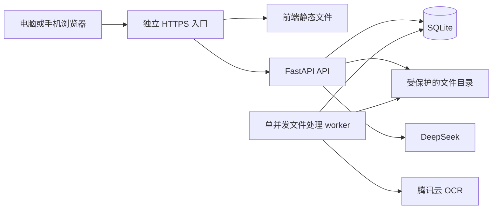

# 市场部 AI 知识库技术方案

| 项目 | 内容 |
| --- | --- |
| 版本 | V0.1，待审阅的推荐方案 |
| 日期 | 2026-10-27 |
| 需求依据 | 《市场部AI知识库-产品需求文档.md》V1.3 |
| 当前阶段 | 技术设计；未编写产品代码，未安装依赖，未连接服务器或调用模型/OCR |
| 已确认条件 | DeepSeek 问答、腾讯云 OCR 免费资源优先、暂不购买域名、现有腾讯云服务器部署 |

本文确定推荐的实现方向及其检查条件。具体依赖版本在实施计划中固定并生成锁文件；本文不把官网能力说明当作本项目已经通过的实测结果。

## 1. 推荐结论

采用 React + TypeScript 前端、FastAPI 后端、SQLite 数据库和文件存储，结合精确记录查询、中文全文检索及 DeepSeek 组织答案。Word、Excel、文字型 PDF 在服务器本地解析；图片和扫描 PDF 页面交给腾讯云 OCR。

服务器部署两个独立常驻进程：一个 API 进程、一个文件处理 worker。前端提前构建为静态文件，服务器不运行前端开发服务器。不在这台机器加载本地大语言模型或 OCR 神经网络模型。

首版不引入 Redis、独立向量数据库、Elasticsearch、微服务集群或新的嵌入模型服务。需要通过标准问题验证全文检索与查询扩展的召回能力；若不能满足 PRD 的效果指标，应报告具体失败样本并调整技术方案，不能降低验收目标或只展示成功样例。

该方案是面向当前资料规模和共用服务器的工程取舍，并不是对服务器资源足够的保证。

## 2. 已知环境与需要实测的事实

| 项目 | 当前信息 | 证据边界 |
| --- | --- | --- |
| 系统 | Ubuntu Server 24.04 LTS 64bit | 用户提供的控制台截图 |
| 硬件与网络 | 2 核 CPU、2 GB 内存、40 GB SSD、3 Mbps 带宽、200 GB/月流量 | 套餐配置，不等于可用资源 |
| 地域与有效期 | 广州，截图到期日 2026-11-23 | 到期后的续费或迁移未落实 |
| 现有业务 | AI 家电保养助手 | 用户确认已部署；其进程、端口、数据路径未在本次核对 |
| 外部服务 | 用户已有 DeepSeek API Key | 未读取密钥，未验证额度、模型权限与接口来源 |
| 访问地址 | 不购买域名，按公网 IP 访问 | 新项目端口和 HTTPS 仍需部署验证 |
| OCR | 选定腾讯云，优先适用免费资源包 | 未确认账号是否已开通、资源包余额和后付费状态 |

部署前只读核对系统、现有服务及启动方式、端口、代理配置、剩余内存、磁盘和外网连通性。发现共用资源不足、入口冲突或旧项目备份条件不明时，先报告；不得通过停止旧服务、覆盖旧文件或重装系统为新项目腾出资源。

## 3. 方案比较

| 方案 | 主要收益 | 主要代价 | 本项目选择 |
| --- | --- | --- | --- |
| SQLite 精确记录查询 + 中文全文检索 + DeepSeek | 运行组件少；可在同一数据库事务内处理版本及查询可见性；适合当前小规模 | 中文分词和查询扩展需设计，语义召回必须实测 | 推荐首版采用 |
| 额外接入嵌入模型与向量检索 | 提供另一种语义召回渠道 | 增加模型、索引及更新一致性工作；仍不能代替精确字段匹配 | 若召回验收确有缺口，再提出调整 |
| 现成知识库平台并行部署 | 可复用部分管理功能 | 共用 2 GB 服务器的资源及依赖成本需评估，现有平台行为未必满足发布和版本规则 | 首版暂不采用 |

技术方案确认不改变文件支持范围、角色权限、答案来源及更新规则。

## 4. 系统组成

- 浏览器仅调用本项目后端，不直接持有或调用模型、OCR 的密钥。
- 上传任务写入数据库，worker 领取并处理；关闭浏览器不影响任务。
- 前端定时查询任务状态，首版无需引入消息队列或 WebSocket。
- API 与 worker 分别启动、分别记录日志；文件处理失败不导致问答进程退出。
- 不把上传文件目录作为公开静态目录；下载和来源预览均经过登录与有效性检查。

## 5. 技术选型

| 模块 | 推荐技术 | 使用方式 |
| --- | --- | --- |
| 前端 | React、TypeScript、Vite | 静态构建；页面按登录、问答、资料管理、来源详情组织 |
| 页面样式 | CSS 与共享设计变量 | 具体视觉风格在页面原型阶段确定，不让技术框架替代设计 |
| 后端 | Python 3.12、FastAPI、Pydantic | 校验请求与响应；生成接口文档；模型调用使用异步 HTTP |
| 数据访问 | SQLAlchemy、Alembic、SQLite | 普通 ORM 会话处理业务；迁移管理表结构；全文索引使用专门的数据访问模块 |
| 中文检索 | SQLite FTS5、jieba 与业务词典 | 先分词再索引；保留原文、编号和短词查询渠道 |
| Word | python-docx | 保留正文、标题、表格和来源顺序 |
| Excel | openpyxl | 只读遍历工作表与单元格，保留原行号；需要时分别检查公式和缓存结果 |
| PDF 文本与表格 | pdfplumber | 按页提取文本、常规表格与坐标，不一次展开整份文档 |
| PDF 页面渲染 | pypdfium2 | 仅对需要 OCR 的页面生成图片；限制单页内存，及时释放渲染对象 |
| 图片检查与预处理 | Pillow | 检查实际格式、像素、方向；处理服务输入限制，保留原图 |
| OCR | 腾讯云官方服务端 SDK | 候选接口为高精度通用文字识别、表格识别 V3；按页面和内容调用 |
| AI | DeepSeek 官方 API | 模型标识通过配置指定；优先评估官方当前的 `deepseek-flash`，实测后固定 |
| 服务运行 | Python 虚拟环境、systemd、现有可复用的入口代理 | 新项目单独运行；不安装或重配与本项目无关的服务 |
| 自动检查 | pytest、前端类型/构建检查、Playwright | 业务与真实外部服务验证分开，验收对应 PRD A-01～A-30 |

开发时确认具体版本、许可证及其与 Python 3.12、Ubuntu 24.04 的兼容性，再形成依赖锁。服务器只安装运行所需内容，Node 构建工具可留在开发环境。

## 6. 数据设计

### 6.1 主要实体

| 实体 | 核心信息与职责 |
| --- | --- |
| User / Session | 用户标识、角色、密码摘要；服务端登录会话及过期信息 |
| Document | 逻辑文件 ID、显示名称、当前有效版本、删除状态；不以文件名充当主键 |
| DocumentVersion | 所属文件、版本号、SHA-256、原文件路径、状态、上传及发布时间、解析报告 |
| ImportJob | 版本 ID、任务状态、当前处理位置、重试次数、领取租约及失败原因 |
| SourceUnit | 页、段落或表格记录，包含原文、字段、页码/行号、坐标、所属版本及预览信息 |
| SearchIndex | SourceUnit 的可检索文本、分词结果、标题与实体检索字段；FTS5 提供正文查询 |
| KnowledgeState | 当前知识库 revision，发布或删除有效资料时递增 |
| Conversation / Message | 所属用户、会话及消息、回答所用 revision、来源单元与结果类型 |
| OperationLog | 上传、发布、替换、删除和处理故障等必要操作；不保存密钥或完整请求正文 |
| OCRCallRecord | 版本/页标识、接口、请求状态、请求 ID及时间；用于去重和排错，不充当腾讯云余额证明 |

### 6.2 表格记录表示

保留工作表名、原始行号、原始表头、各单元格原值和数据类型。识别“门店、物品、位置、联系人、电话”等常用字段别名用于查询，但不把所有资料强制转换成固定的店家/物品数据库。

编号、电话、文本位置等值优先按字符串保留；显示值和原始值的差别应可核对。公式缓存缺失不能作为有效业务值。重复表头、合并表头、异常维度和隐藏工作表的处理结果进入预览报告。

对无法确定字段关系的表格阻止作为确定记录发布，提示用户提供清晰或规则版本。空白字段表示未知，不由模型补齐。

### 6.3 存储与一致性

- 文件使用随机内部标识存储，用户文件名仅用于显示；防止路径穿越。
- SQLite 开启外键约束，评估 WAL 模式；写事务保持短小，设置明确的锁等待时间。
- 解析和外部 API 调用不持有长时间数据库写事务。
- 备份使用数据库一致性备份方式并关联文件清单，不在 WAL 活跃写入时仅复制主数据库文件。
- 版本内容与索引在待发布状态准备好，再切换有效版本；查询始终经过有效版本过滤。

## 7. 文件导入与 OCR

### 7.1 通用导入流程

上传校验 → 生成文件指纹 → 建立版本与任务 → worker 处理 → 内容及来源保存 → 待管理员确认 → 发布。

任务使用数据库领取与租约机制。worker 重启后可恢复未完成任务；采用版本、页和接口作为检查点标识，已经成功保存的识别结果尽量复用，避免重复扣减 OCR 额度。

删除或取消任务后，租约恢复不能重新激活该任务。worker 在调用外部 OCR 前及提交解析结果前分别检查任务取消标记、文件删除状态和版本身份；检查未通过即终止，释放临时资源，不能将迟到结果写为待发布或有效内容。

同字节文件的重复导入与替换规则按 PRD 执行；指纹检查与任务创建之间需防止并发重复。不同内容的同名文件必须显式选择新增或替换。

### 7.2 分类型处理

| 输入 | 处理策略 |
| --- | --- |
| Word | 按原文顺序处理正文与表格，建立段落/表格标识；内嵌图片不纳入首版 OCR 承诺 |
| Excel | 逐工作表、逐行提取；按规则识别表头，保存行记录及原字段；所有工作表处理结果可见 |
| 文字型 PDF | 按页提取正文和常规表格；去重相同页面内容的重复提取结果，保持页码 |
| 扫描/混合 PDF | 按页检查是否存在可用文本；需要识别的页渲染成图片并调用 OCR，不将整份 PDF 误判为一种类型 |
| 图片 | 校验内容与像素，修正显示方向，选择文字或表格接口；保留原图供核对 |

页面文本可用性采用明确规则和异常提示，不宣称能完美识别所有扫描件；有问题的页面必须出现在处理报告。失败页存在时不允许把整份资料标为可发布。

### 7.3 腾讯云 OCR 接入策略

- 普通通知或正文图优先调用通用文字识别；规则表格图调用表格识别 V3，保存单元格结构及定位。
- 页面类型无法可靠判定时在导入检查中提示，可在失败重试流程中明确处理方式；不对每页默认重复调用全部接口。
- 产品的 20 MB 文件和 2,000 万像素上限不等于 OCR 单次请求上限。服务端在调用前校验编码体积、尺寸和长宽比；必要时分块处理并保留到原页的定位映射，不静默丢弃内容。
- PDF 逐页处理，不能把多页文件只识别第一页后提示完整成功。
- OCR 单并发开始；限流时有界退避，额度错误直接暂停，不无限重试。
- 网络超时后的重试可能产生再次调用费用，处理报告记录尝试次数；不能宣称远端请求严格只发生一次。
- 接入前检查具体免费资源包及后付费设置；如果账号无法满足免费使用条件，报告原因，不偷偷启用收费。
- 只读文本的 Word、Excel、PDF 不调用 OCR；文件发布后，问答使用保存的结果，不重复识别同一张图。

原图、识别文字和表格记录需要同时可核对。预览确认降低错误入库风险，仍需通过冻结资料测试识别质量。

## 8. 查询与回答

### 8.1 查询流程

1. 校验登录、会话所有者并读取当前 revision。
2. 从本会话明确的实体条件及本次问题获取查询意图；上下文不明确时不强行继承。
3. 先执行精确字段与别名查询，再执行中文全文检索。
4. 必要时通过 DeepSeek 将问题转换为受约束的检索词或同义表达，再检索一次；模型不得生成可执行 SQL。
5. 合并去重候选，识别同名、缺失字段和冲突。多个实体需要澄清，不能按相似度第一名直接回答。
6. 将相关来源片段及内部来源 ID 交给 DeepSeek，要求只基于证据组织答案。
7. 服务端检查来源 ID、实体一致性、精确字段及当前版本；检查失败时澄清或说明依据不足。
8. 在同一个短写事务内再次核对 revision 并保存回答及来源：变化时丢弃待发答案并记录知识变更结果；未变化时完成回答写入。以该事务提交作为回答完成点，提交后才向浏览器返回结果。模型调用在事务外，防止校验与保存之间被并发发布穿插。

首版一次返回完整答案，不先把未经最终版本检查的事实流式输出给用户，避免回答中途资料更新造成旧事实已经显示。

### 8.2 中文检索与精确字段

不能直接假设 FTS5 默认分词能处理所有中文问句。入库和查询采用一致的中文分词流程，添加门店名、物品名及明确别名；编号、电话、短名称保留精确匹配及受限子串查询。

FTS5 使用分词后的查询文本排序，原始 SourceUnit 负责显示和溯源。模型生成的同义词仅作为检索线索，不能直接写成已确认业务别名或答案事实。

设定候选与上下文大小上限，超过上限时要求缩小条件或分批检索；不得因为截断候选而误称“只有一家店”。查询扩展和答案生成均纳入总超时预算。

### 8.3 事实、歧义与冲突

- 电话、位置、编号、地址等精确字段优先由后端从匹配记录构造，AI 用于理解问题和组织表达。
- 模型不能混合不同门店、不同物品或不同资料版本的字段。
- 明确同一实体同一字段出现不同值时返回冲突及全部相关来源，不根据上传时间裁定业务真伪。
- 同名但无法确认是否同一实体时返回候选，不擅自合并。
- 正文问题可归纳，但每项业务规定需有来源支持。来源不足时回答已知部分并说明缺失部分。
- 返回类型区分 answer、clarification、not_found、conflict、service_error、knowledge_changed，前端分别展示。

### 8.4 来源引用

模型只能引用候选列表中的内部来源 ID。后端据此生成文件名、版本、工作表/行号、段落或页码，拒绝不存在或不属于本次证据集的 ID。

来源内容通过登录后接口访问；历史消息的来源若失效，只返回必要状态。被删除原件、提取内容和原图不可经旧链接访问。

## 9. 发布、替换和删除

### 9.1 发布与替换

解析完成时，新版资料及索引仍不可见。管理员确认后，在一个短事务中校验任务完成状态、切换 Document 当前有效版本并递增 revision。

全文查询与精确查询必须关联 Document 当前版本及删除状态，不能直接查询所有历史索引。旧索引可异步清理，但切换后立即不再可见。

发布冲突采用当前版本检查；两个管理员或重复点击不能让过时的发布请求覆盖刚生效版本。发布响应仅在提交成功后返回新 revision 和生效时间。

### 9.2 删除

在事务中标记逻辑文件删除、撤销有效版本、递增 revision；所有内容与原件接口立刻执行状态检查。物理文件与旧索引由清理任务后续处理，清理故障不能恢复业务访问权限。

同一删除事务取消该文件尚未完成的导入任务。worker 按第 7.1 节在外部调用前和结果提交前复核状态，不再开始下一页或重试；已发送到腾讯云的请求未必能撤销及退回额度，其迟到结果必须丢弃，不能恢复已删除内容或任务。

已删除文件重新导入时建立新的资料关系，不重新开放原来的历史来源地址。

### 9.3 会话与缓存

首版不建设跨用户答案缓存。检索缓存如确有需要，必须包含 revision。聊天历史用于理解追问中的实体，不替代重新检索当前事实。

只要问答过程中 revision 改变，就中止本次结果；这是首版保守一致性策略，即使变更涉及其他文件也适用。

## 10. 接口边界

下列为接口分组及行为约定，字段类型、错误码和完整请求响应在实施计划中固定，并由 OpenAPI 与前端类型保持一致。

| 分组 | 主要接口与行为 |
| --- | --- |
| 登录 | 登录、退出、当前用户；服务端会话 Cookie |
| 文件 | 上传、列表、详情、任务状态；管理员权限 |
| 内容检查 | 按版本分页查看段落/记录/页面报告，确认发布；管理员权限 |
| 版本管理 | 现有文件上传新版、发布、删除；包含并发版本检查 |
| 问答 | 创建/列出/删除本人会话，发送问题，获取消息与来源 |
| 来源 | 校验登录、来源有效性及历史消息所属用户后返回必要依据 |
| 健康状态 | 最小健康检查；不暴露配置、文件路径、密钥或数据库内容 |

异常响应提供稳定的业务错误类型，如不支持文件、超限、额度不足、发布冲突、知识变更和外部服务不可用。服务异常不能转成“知识库没有答案”。

## 11. 登录与文件保护

- 预置管理员、员工账号，使用密码摘要保存凭据，初始化密码由部署配置提供。
- Cookie 使用项目专属名称，避免与家电项目重名；开启 HttpOnly、HTTPS 下的 Secure 和适当 SameSite 设置。
- 写操作执行来源或 CSRF 校验，服务端校验角色和个人会话所有者。
- API 与 OCR 凭据分别配置，仅服务端可读；不在运行日志、前端构建、接口错误或来源内容中出现。
- 上传检查实际格式、解压规模、页数、行数和像素；防止压缩文件、超大图片或恶意文档拖垮共用服务器。
- 图片原件、PDF 和 Office 原件通过受保护接口提供；不以猜得到的公开 URL 代替鉴权。
- 文档中的提示词不具有系统指令权限；首版问答不具备运行命令、访问任意网址或修改业务数据的工具。

## 12. 运行和无域名部署

### 12.1 部署布局

建议分别使用 `/opt/mktkb` 保存应用、`/var/lib/mktkb` 保存业务数据、`/etc/mktkb.env` 保存运行配置；这些是拟定目录，部署前核对是否已存在。

采用独立非特权运行用户、独立虚拟环境与独立 systemd unit。API 监听回环地址，外部访问经新增入口转发；外部端口先检查占用和防火墙，再决定，不能抢占旧项目入口。

API 先使用一个 worker；文件处理单独一个 worker，单任务按页顺序处理。外部 HTTP 设置连接、读取和总时限；数据库写入保持短事务，避免 OCR 处理期间阻塞员工问答。

### 12.2 无域名的 HTTPS

推荐评估公网 IP 证书，访问形式为 `https://公网IP:独立HTTPS端口`。Let's Encrypt 当前支持 IP 地址证书，证书生命周期较短，需要自动续期和续期后加载新证书。

签发验证所需入口与现有项目共用机器，必须先检查端口及代理：优先考虑在可复用的既有 Web 服务中新增证书挑战路径，避免停止旧站点；不能直接运行会抢占现有端口的临时验证服务。

能否签发、外部验证是否可达、浏览器是否信任、自动续期是否工作，都需要实测。若现有入口无法安全复用，应先报告可行替代方式，不把 HTTP 测试地址或浏览器证书警告当作 HTTPS 交付已完成。

IP 地址访问解决的是访问入口；不应据此承诺任何部署场景都没有其他平台要求。此次暂不购域名，后续引入域名再检查对应解析与备案条件。

### 12.3 资源、备份与旧项目保护

- 开发及构建在本地完成，服务器部署构建产物，避免构建过程抢占旧项目内存。
- 部署前记录旧项目健康基线与必要备份；部署后验证两项目访问和服务状态。
- 限制文件处理并发与单页内存，配置日志轮转和过期临时文件清理；实际资源上限依据峰值检查确定。
- 如果 2 GB 共用资源不能支持目标，给出测得的内存、磁盘或延迟证据，再提出资源调整，不宣称必须能装下。
- 备份包含一致性数据库、有效文件及必要版本清单；恢复演练使用独立目录，不覆盖运行中的两个项目。
- 记录 2026-11-23 的资源到期信息，部署说明明确续费或迁移安排尚待落实。

## 13. 建议实施顺序与检查点

本节为阶段顺序；具体任务、文件、接口签名和检查命令另写实施计划，不直接据此开始编码。

| 阶段 | 可检查的交付 | 主要对应 PRD 验收 |
| --- | --- | --- |
| 1. 最小闭环 | 登录、Excel 导入检查发布、精确查询、DeepSeek 回答及来源、替换后新答案 | A-01～A-04、A-07、A-08、A-14、A-17、A-29 |
| 2. 完整文件处理 | Word、两类 PDF、图片、腾讯 OCR、失败报告、免费额度异常与重试 | A-03～A-06、A-09、A-16、A-22、A-30 |
| 3. 回答及一致性 | 别名、多轮追问、无答案、歧义、冲突、删除、并发版本变化、会话隔离 | A-10～A-15、A-18～A-21、A-23、A-25、A-26 |
| 4. 完整交付 | 页面原型对应实现、手机基本使用、持久化、独立部署、HTTPS、备份说明 | A-24、A-27、A-28，并回归全部验收 |

各阶段均需保留失败项；不能以单元测试全通过替代真实服务、实际文件或目标服务器验收。

## 14. 验证与风险清单

| 项目 | 必须取得的证据 | 当前状态 |
| --- | --- | --- |
| 中文检索 | 冻结资料上精确查询、同义问法、短名称及无词面重合问题的召回与答案结果 | 未执行 |
| OCR 质量 | 正文、规则表格、电话、位置编号、模糊页及部分失败的原图对照结果 | 未执行 |
| 免费使用 | 所选接口对应免费包、余额和后付费配置，以及额度耗尽时行为 | 未执行 |
| 模型接入 | 具体模型、接口来源、用模拟问题与片段取得的真实响应和用量 | 未执行 |
| 版本正确性 | 替换、删除、同会话追问与并发变更测试 | 未执行 |
| 共用资源 | 两项目同时运行时的峰值内存、磁盘、响应与服务健康 | 未执行 |
| HTTPS | 公网 IP 访问可信证书、签发和自动续期、旧项目保持可用 | 未执行 |
| 备份恢复 | 在独立目录恢复文件与数据库后查询可用 | 未执行 |

在具体调用前确定模拟载荷、目标服务与测试范围；真实企业资料不在现有授权范围。日志中的调用用量、开发自测、模拟服务检查、真实服务验证和人工验收分别标注。

## 15. 参考资料

以下官方资料用于核对组件能力；接口限额、模型名称及工具支持在实际接入时再次确认。

- [React TypeScript](https://react.dev/learn/typescript)、[Vite](https://vite.dev/guide/)。
- [FastAPI 部署概念](https://fastapi.tiangolo.com/deployment/concepts/)、[SQLAlchemy SQLite](https://docs.sqlalchemy.org/en/20/dialects/sqlite.html)。
- [SQLite FTS5](https://www.sqlite.org/fts5.html)、[jieba](https://github.com/fxsjy/jieba)。
- [python-docx](https://python-docx.readthedocs.io/en/latest/)、[openpyxl 只读模式](https://openpyxl.readthedocs.io/en/stable/optimized.html)。
- [pdfplumber](https://pypi.org/project/pdfplumber/)、[pypdfium2](https://pypdfium2.readthedocs.io/en/stable/)。
- [DeepSeek 接入](https://api-docs.deepseek.com/)。
- [腾讯云 OCR 免费额度](https://cloud.tencent.com/document/product/866/35945)、[计费概述](https://cloud.tencent.com/document/product/866/17619)、[表格识别 V3](https://cloud.tencent.com/document/product/866/86721)。
- [Let's Encrypt IP 证书与 Certbot](https://letsencrypt.org/2026/03/11/shorter-certs-certbot.html)。
